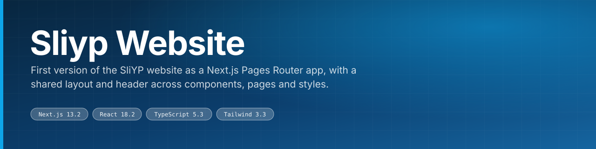
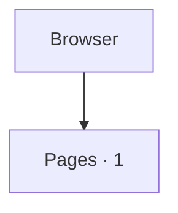

<div align="center">



First version of the SliYP website as a Next.js Pages Router app, with a shared layout and header across components, pages and styles.

<br>

[](https://nextjs.org) [](https://react.dev) [](https://www.typescriptlang.org) [](https://tailwindcss.com)

 

</div>

---

## What this is

Version 1.0 of the SliYP website, built as a Next.js Pages Router application (`sliyp_website` in package.json) with a shared `Layout` wrapper in `_app.tsx` and a `Header` component. Later superseded by the hand-written SCSS site.

The code is laid out as:

- `components/` — UI components
- `public/` — static assets
- `pages/` — pages
- `styles/` — stylesheets

<div align="center">

|  |  |  |
|:--:|:--:|:--:|
| **2** | **7** | **1** |
| pages | components | docs |

</div>

---

## Architecture



<sub>Derived from the directories present in this repository.</sub>

---

## Surfaces

**Routes** (1)

|  |  |  |
|---|---|---|
| `/index` |  |  |

---

## Stack

| Layer | Choice |
|---|---|
| [Next.js](https://nextjs.org) | v13.2 |
| [React](https://react.dev) | v18.2 |
| [TypeScript](https://www.typescriptlang.org) | v5.3 |
| [Tailwind](https://tailwindcss.com) | v3.3 |

---

## Getting started

```bash
git clone https://github.com/gowtham-creator/SLiYP-version-1.0.git
cd SLiYP-version-1.0
npm install
npm run dev
```

### Scripts

| Command | Runs |
|---|---|
| `npm run dev` | `next dev` |
| `npm run start` | `next start` |
| `npm run build` | `next build` |
| `npm run lint` | `next lint` |

---

## Project structure

| Path | Contents | Files |
|---|---|---|
| `components/` | UI components | 7 |
| `public/` | static assets | 4 |
| `pages/` | pages | 2 |
| `styles/` | stylesheets | 1 |

<sub>22 tracked files in total.</sub>

---

<div align="center">
<sub><a href="https://github.com/gowtham-creator/SLiYP-version-1.0">gowtham-creator/SLiYP-version-1.0</a></sub>
</div>
